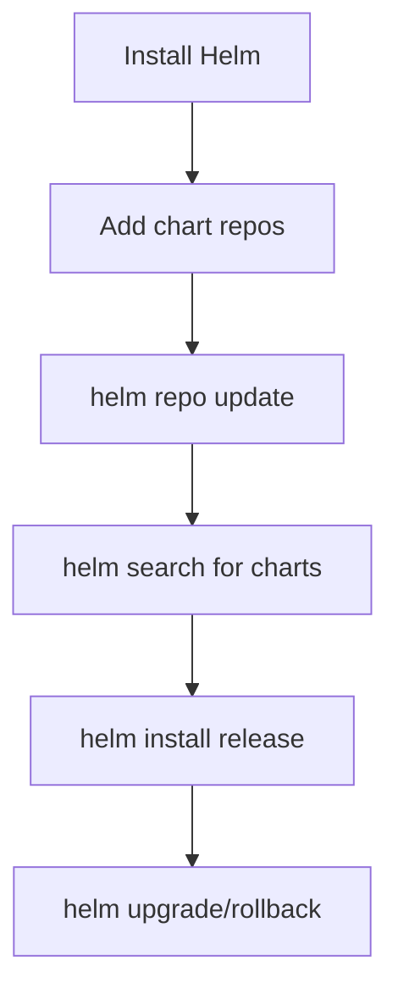

> 💡 **Quick Answer:** Install Helm 3 on Debian and configure chart repositories. Covers package manager install, script install, and shell completion for Debian 11/12.

## The Problem

You need Helm installed on Debian (Debian 11/12) to manage Kubernetes application deployments with charts.

## The Solution

### Install Helm on Debian

```bash
# Method 1: Official script (works everywhere)
curl https://raw.githubusercontent.com/helm/helm/main/scripts/get-helm-4 | bash

# Method 2: apt repository
curl -fsSL https://packages.buildkite.com/helm-linux/helm-debian/gpgkey > "${TMPDIR:-/tmp}/helm.asc"
gpg --import --import-options=show-only --with-colons "${TMPDIR:-/tmp}/helm.asc" | awk -F: '$1 == "fpr" {print $10}' | head -n 1
# Must print DDF78C3E6EBB2D2CC223C95C62BA89D07698DBC6; stop if it does not
sudo install -m 0644 -Dt /etc/apt/keyrings/ "${TMPDIR:-/tmp}/helm.asc"
sudo tee /etc/apt/sources.list.d/helm-stable-debian.sources > /dev/null <<EOF
Types: deb
URIs: https://packages.buildkite.com/helm-linux/helm-debian/any/
Suites: any
Components: main
Signed-By: /etc/apt/keyrings/helm.asc
EOF
sudo apt-get update
sudo apt-get install helm

# Verify
helm version

# Add popular chart repos
helm repo add bitnami https://charts.bitnami.com/bitnami
helm repo add jetstack https://charts.jetstack.io
helm repo add prometheus-community https://prometheus-community.github.io/helm-charts
helm repo update

# Install your first chart
helm install cert-manager jetstack/cert-manager \
  --namespace cert-manager --create-namespace --set crds.enabled=true

# Helm auto-completion
echo 'source <(helm completion bash)' >> ~/.bashrc
source ~/.bashrc
```

### Verify Installation

```bash
helm version
# version.BuildInfo{Version:"v4.3.x", ...}

# List installed releases
helm list -A

# Search for charts
helm search repo nginx
helm search hub prometheus
```



## Common Issues

- **kubectl not configured** — Helm uses your kubeconfig; ensure `kubectl get nodes` works first
- **Helm 2 vs 3** — Helm 3 has no Tiller; if you see Tiller errors, you have Helm 2
- **Repository not found** — run `helm repo update` after adding repos

## Best Practices

- **Always use `--namespace` and `--create-namespace`** for clean isolation
- **Use `values.yaml` files** instead of `--set` flags for reproducibility
- **Pin chart versions** in production: `helm install --version 1.2.3`

## Key Takeaways

- Helm is the standard package manager for Kubernetes
- The official install script works on every Linux distro
- Always add and update repos before searching for charts
- Use shell completion for productivity
