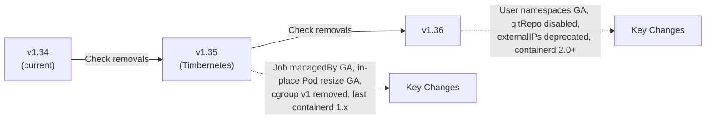

> 💡 **Quick Answer:** Kubernetes v1.35 (Timbernetes) and v1.36 remove no REST API versions (the last removals were in v1.32), but they do change the node requirements: v1.35 drops cgroup v1 support and is the last release to support containerd 1.x, and v1.36 permanently disables the `gitRepo` volume plugin and deprecates Service `externalIPs`. Before upgrading: audit APIs with Pluto, check node runtimes and cgroup version, back up etcd, test in staging, and update Helm charts and operators.

## The Problem

Every Kubernetes release deprecates or removes APIs, changes default behaviors, and graduates features. Upgrading without checking these changes causes broken deployments, failed CI/CD, and production incidents. This checklist covers both v1.35 and v1.36 to help teams planning multi-version upgrades.



## The Solution

### Pre-Upgrade Checklist

```bash
# Step 1: Check current version
kubectl version

# Step 2: Audit deprecated APIs
# Option A: kubectl-deprecations plugin
kubectl deprecations --k8s-version=1.35

# Option B: Pluto (by FairwindsOps)
pluto detect-all-in-cluster --target-versions k8s=v1.35

# Option C: Manual check with API discovery
kubectl get --raw /apis | jq -r '.groups[].preferredVersion.groupVersion'

# Step 3: Backup etcd
ETCDCTL_API=3 etcdctl snapshot save /backup/etcd-pre-upgrade-$(date +%Y%m%d).db \
  --endpoints=https://127.0.0.1:2379 \
  --cacert=/etc/kubernetes/pki/etcd/ca.crt \
  --cert=/etc/kubernetes/pki/etcd/server.crt \
  --key=/etc/kubernetes/pki/etcd/server.key

# Step 4: Check node readiness
kubectl get nodes -o wide
kubectl top nodes

# Step 5: Check PodDisruptionBudgets (a PDB with 0 allowed disruptions blocks drains in any version)
kubectl get pdb -A -o wide

# Step 6: Check container runtime (containerd 2.0+ needed before 1.36) and cgroup version (v2 needed for 1.35+)
kubectl get nodes -o wide          # CONTAINER-RUNTIME column
stat -fc %T /sys/fs/cgroup/         # on each node: cgroup2fs = v2, tmpfs = v1
```

### Kubernetes v1.35 Changes (Timbernetes)

#### Graduated to Stable (GA)

| Feature | What Changed |
|---------|-------------|
| **Job `managedBy` field** | External controllers (Kueue, Volcano) manage Jobs natively |
| **In-place Pod resource resize** | Change container CPU/memory requests and limits without recreating the Pod |
| **Fine-grained SupplementalGroups control** | `supplementalGroupsPolicy` controls how supplemental groups are applied |
| **Kubelet configuration drop-in directory** | Merge kubelet config fragments from a drop-in directory |

This is a selection; see the official v1.35 release post for the full stable list.

#### API Removals in v1.35

None. The official Deprecated API Migration Guide lists no API versions removed in v1.33 through v1.36. Older removals still show up in stale manifests and charts, so keep scanning:

```yaml
# Removed in v1.32: flowcontrol.apiserver.k8s.io/v1beta3
# BEFORE:
apiVersion: flowcontrol.apiserver.k8s.io/v1beta3
kind: FlowSchema
# AFTER:
apiVersion: flowcontrol.apiserver.k8s.io/v1
kind: FlowSchema
---
# Removed in v1.26: autoscaling/v2beta2 (if any lingering manifests)
# Use: autoscaling/v2
```

#### Behavior Changes in v1.35

```yaml
# 1. cgroup v1 support removed
# kubelet fails to start on nodes that only support cgroup v1.
# FIX: move those nodes to a Linux distribution/config with cgroup v2 before upgrading.

# 2. Final release supporting containerd 1.x
# Before upgrading to v1.36, every node must run containerd 2.0 or later.

# 3. kube-proxy ipvs mode deprecated
# kube-proxy logs a warning on startup; nftables is the recommended replacement on Linux.
```

### Kubernetes v1.36 Changes

#### Graduated to Stable (GA)

| Feature | What Changed |
|---------|-------------|
| **User Namespaces in Pods** | `hostUsers: false` maps container root to an unprivileged host UID |
| **Mutating Admission Policies** | CEL-based mutation without webhooks |
| **SELinux mount-time labeling** | Faster volume relabeling via mount options; Pods sharing volumes with different labels may need `seLinuxChangePolicy: Recursive` |
| **Image / OCI volume source** | Mount OCI artifacts or images as read-only volumes |

This is a selection; see the official v1.36 release post for the full stable list. (DRA partitionable devices are beta in v1.36, not GA.)

#### Behavior Changes in v1.36

```yaml
# 1. gitRepo volume plugin permanently disabled
# Pods using a gitRepo volume no longer start.
# FIX: clone in an init container or use a git-sync style sidecar.

# 2. Service .spec.externalIPs deprecated (warnings only for now)
# kube-proxy support is disabled no earlier than v1.40 (opt-back-in available).

# Not a 1.36 change, but check before every drain:
# a PDB that allows 0 disruptions makes node drain fail in any version.
# FIX: Ensure PDBs allow at least 1 disruption
apiVersion: policy/v1
kind: PodDisruptionBudget
metadata:
  name: my-app-pdb
spec:
  # BAD: maxUnavailable 0 blocks all drains
  # maxUnavailable: 0
  # GOOD: allow at least 1
  maxUnavailable: 1
  selector:
    matchLabels:
      app: my-app

# 3. containerd 2.0 or later required (v1.35 was the last release supporting containerd 1.x)
# Verify: kubectl get nodes -o wide  (or: crictl version on the node)
```

### Upgrade Procedure

```bash
# 1. Upgrade control plane (one node at a time)
sudo kubeadm upgrade plan
sudo kubeadm upgrade apply v1.35.0

# 2. Upgrade kubelet and kubectl on each node
sudo apt-get update
sudo apt-get install -y kubelet=1.35.0-1.1 kubectl=1.35.0-1.1
sudo systemctl daemon-reload
sudo systemctl restart kubelet

# 3. For managed Kubernetes (EKS/GKE/AKS)
# EKS:
aws eks update-cluster-version --name my-cluster --kubernetes-version 1.35

# GKE:
gcloud container clusters upgrade my-cluster --master --cluster-version 1.35

# AKS:
az aks upgrade --resource-group myRG --name myCluster --kubernetes-version 1.35
```

### Post-Upgrade Validation

```bash
# Verify all nodes are Ready and running new version
kubectl get nodes -o wide

# Check for pod restarts or failures
kubectl get pods -A --field-selector=status.phase!=Running,status.phase!=Succeeded

# Verify CoreDNS, kube-proxy, CNI are healthy
kubectl get pods -n kube-system

# Run conformance tests (optional but recommended)
sonobuoy run --mode=quick
sonobuoy status
sonobuoy results $(sonobuoy retrieve)

# Check deprecated API usage in audit logs
grep -E "v1beta|deprecated" /var/log/kubernetes/audit.log | head -20
```

### Helm Chart Compatibility Check

```bash
# Check if Helm charts use deprecated APIs
for release in $(helm list -A -q); do
  echo "=== $release ==="
  helm get manifest $release | grep "apiVersion:" | sort -u
done

# Update charts to latest versions
helm repo update
helm upgrade my-release my-chart --version <latest>
```

## Common Issues

| Issue | Cause | Fix |
|-------|-------|-----|
| `kubectl apply` fails after upgrade | Deprecated API in YAML | Update `apiVersion` to GA version |
| Pods stuck in Pending | New scheduling gates | Check `spec.schedulingGates` |
| Node drain fails | PDB allows 0 disruptions (any version) | Set `maxUnavailable: 1` minimum |
| kubelet fails to start after upgrade | cgroup v1 node (1.35+) or containerd 1.x (1.36) | Move node to cgroup v2 and containerd 2.0+ |
| Pods with `gitRepo` volume fail (1.36) | gitRepo plugin disabled | Use an init container or git-sync sidecar |
| Operator CrDs fail validation | CRD schema stricter | Update operator to latest version |

## Best Practices

- **Upgrade one minor version at a time** — never skip (1.34 → 1.35 → 1.36)
- **Always backup etcd first** — rollback without it is nearly impossible
- **Test in staging** — reproduce your workloads before touching production
- **Audit deprecated APIs before upgrade** — Pluto or kubectl-deprecations
- **Update operators first** — cert-manager, Prometheus, Istio must support the new K8s version
- **Read the changelog** — `kubernetes.io/blog` for each release has breaking changes

## Key Takeaways

- Kubernetes v1.35: Job `managedBy` GA, in-place Pod resize GA, cgroup v1 removed, last release with containerd 1.x
- Kubernetes v1.36: User Namespaces GA, Mutating Admission Policies GA, `gitRepo` disabled, `externalIPs` deprecated
- No REST API versions were removed in v1.33–v1.36 (flowcontrol v1beta3 went in v1.32, autoscaling/v2beta2 in v1.26)
- Always audit deprecated APIs before upgrading: `pluto detect-all-in-cluster`
- Backup etcd before every upgrade — it's your rollback safety net
- Upgrade one version at a time: 1.34 → 1.35 → 1.36
- Check Helm charts, operators, and CRDs for compatibility before upgrading
