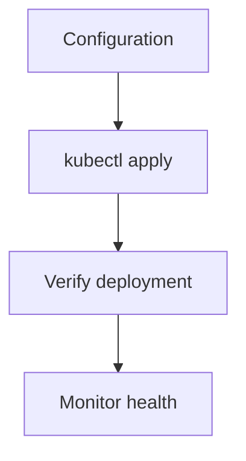

> 💡 **Quick Answer:** Verify container image signatures with Cosign and Sigstore on Kubernetes. Policy enforcement with Kyverno, supply chain security, and SBOM attestation.

## The Problem

Teams need production-ready guidance for cosign image verification kubernetes on Kubernetes. This recipe provides step-by-step configuration with YAML examples, common pitfalls, and best practices from real-world deployments.

## The Solution

### Sign and Verify with Cosign

```bash
# Generate a key pair (cosign.key / cosign.pub)
cosign generate-key-pair

# Sign the image by digest after it is pushed to the registry
cosign sign --key cosign.key registry.example.com/myapp@sha256:<digest>

# Verify the signature
cosign verify --key cosign.pub registry.example.com/myapp@sha256:<digest>
```

### Deployment (Kyverno Policy)

```yaml
apiVersion: kyverno.io/v1
kind: ClusterPolicy
metadata:
  name: verify-image-signatures
spec:
  validationFailureAction: Enforce
  webhookTimeoutSeconds: 30
  rules:
    - name: verify-cosign-signature
      match:
        any:
          - resources:
              kinds: ["Pod"]
      verifyImages:
        - imageReferences: ["registry.example.com/*"]
          attestors:
            - entries:
                - keys:
                    publicKeys: |-
                      -----BEGIN PUBLIC KEY-----
                      <contents of cosign.pub>
                      -----END PUBLIC KEY-----
```

```bash
kubectl apply -f verify-image-signatures.yaml
kubectl get clusterpolicy verify-image-signatures
```



## Common Issues

**Configuration not taking effect**

Check namespace and resource names match. Use `kubectl describe` to see events and status conditions.

**Pods not starting after changes**

Review events: `kubectl get events --sort-by=.metadata.creationTimestamp -n production`. Check for resource constraints or missing dependencies.

## Best Practices

- **Test in staging first** — validate all configuration changes before production
- **Version control everything** — all YAML in Git with proper review
- **Monitor after changes** — watch metrics and logs for 30 minutes post-deploy
- **Document decisions** — record why specific settings were chosen
- **Automate with GitOps** — ArgoCD or Flux for consistent deployments

## Key Takeaways

- Cosign Image Verification Kubernetes is essential for production Kubernetes clusters
- Start with defaults, tune based on monitoring data
- Always test changes in non-production first
- Combine with other security and observability tools for defense in depth
- Keep configurations in version control for audit and rollback
