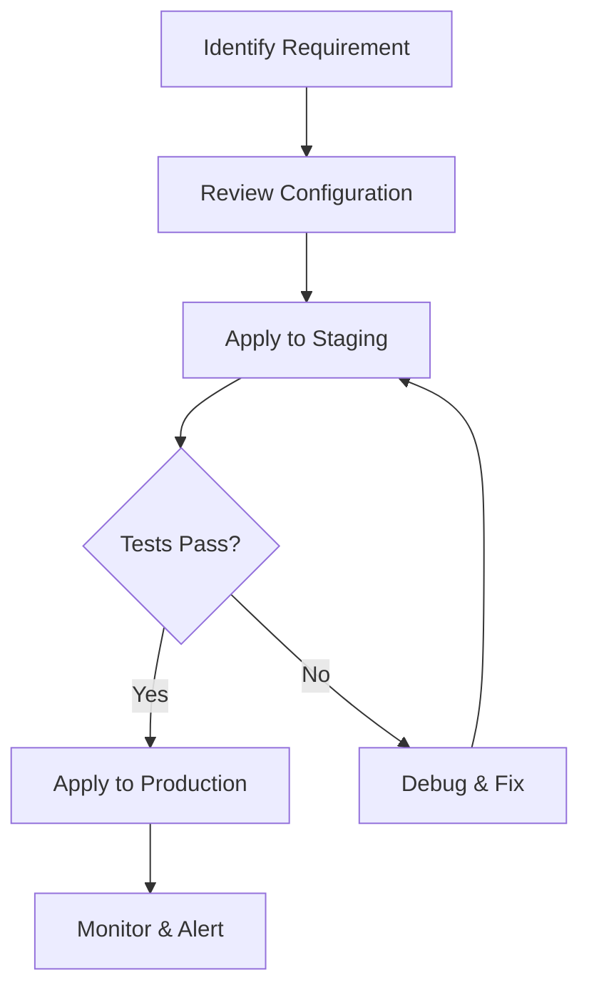

> 💡 **Quick Answer:** Scan container images with Trivy on K8s. Admission webhook, CI/CD integration, CIS benchmarks, and vulnerability reporting.

## The Problem

Teams running production K8s clusters need trivy image scanning kubernetes for reliability, security, and operational excellence. Misconfiguration leads to outages, security gaps, or wasted resources.

## The Solution

### Prerequisites

```bash
# Verify cluster access
kubectl cluster-info
kubectl get nodes
```

### Scan Images in CI (Before Deploy)

```bash
# Fail the pipeline on HIGH or CRITICAL findings
trivy image --severity HIGH,CRITICAL --exit-code 1 registry.example.com/myapp:v1.2.3

# Scan the workloads running in one namespace
trivy k8s --include-namespaces production --report summary
```

### Deployment (Trivy Operator for Continuous Scanning)

```bash
helm repo add aqua https://aquasecurity.github.io/helm-charts/
helm repo update
helm install trivy-operator aqua/trivy-operator \
  --namespace trivy-system \
  --create-namespace
```

### Verification

```bash
# Operator is running
kubectl get pods -n trivy-system

# One VulnerabilityReport per scanned container
kubectl get vulnerabilityreports -n production
```



## Common Issues

**Configuration not taking effect**

Verify the resource exists in the correct namespace. Check for typos in label selectors. Use `kubectl get events` to see scheduling or admission errors.

**Performance degradation after changes**

Monitor resource usage before and after. Use `kubectl top pods` and check Prometheus metrics. Roll back if metrics degrade: `kubectl rollout undo`.

**RBAC permission denied**

Ensure the ServiceAccount has the required ClusterRole or Role bindings. Use `kubectl auth can-i` to verify permissions.

## Best Practices

- **Test in staging first** — never apply untested configs to production
- **Use GitOps** — version all manifests in Git for audit trail and rollback
- **Monitor after deployment** — set up alerts for key metrics within 15 minutes
- **Document decisions** — record why configurations were chosen in PR descriptions
- **Automate validation** — add CI checks for YAML syntax and policy compliance

## Key Takeaways

- Trivy Image Scanning Kubernetes is critical for production K8s operations
- Start with safe defaults and tune based on real monitoring data
- Always test changes in non-production environments first
- Combine with observability for full visibility into cluster behavior
- Automate repetitive tasks with CI/CD pipelines and GitOps
